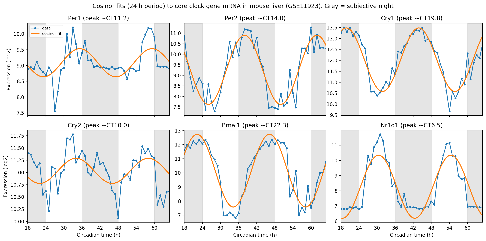

# Circadian rhythms in mouse liver gene expression

Detecting and characterising 24-hour rhythms in core clock gene mRNA in a public, high-resolution mouse liver time series, using cosinor regression in Python.

## Biological question

The mammalian circadian clock is built from transcription–translation feedback loops. CLOCK:BMAL1 activates transcription of *Per*, *Cry* and *Nr1d1*. PER and CRY proteins then repress CLOCK:BMAL1, shutting down their own transcription, while REV-ERBα (encoded by *Nr1d1*) represses *Bmal1*.

This project asks: **do the core clock genes show 24-hour mRNA rhythms in mouse liver under constant darkness, and in what order do they peak across the circadian cycle?**

## Data

- **Dataset:** [GEO GSE11923](https://www.ncbi.nlm.nih.gov/geo/query/acc.cgi?acc=GSE11923) (Hughes et al., 2009).
- **Design:** C57BL/6J mice were entrained to a 12 h light : 12 h dark cycle, then released into constant darkness. Liver was collected every hour for 48 hours (CT18–CT65), with RNA from 3–5 mice pooled per time point, giving 48 samples.
- **Platform:** GPL1261, Affymetrix Mouse Genome 430 2.0 Array (45,101 probesets).
- Data were used as deposited in GEO (normalised by the original authors). The notebook downloads the data directly from GEO, so no data files are stored in this repository.

## Methods

1. **Log₂ transformation** of expression values (raw intensities spanned a ~60,000-fold range).
2. **Probe-to-gene mapping** using the GEO platform annotation for GPL1261 (2016). *Bmal1* appears under its former official symbol, *Arntl*. Where a gene had several probesets, the one with the **highest mean expression** was used: a selection rule independent of rhythmicity, to avoid biasing the test.
3. **Sample times** were extracted from GEO sample titles and checked: 48 samples, in time order, exactly 1 hour apart.
4. **Cosinor regression:** each gene was fitted with y(t) = M + A·cos(2π(t − φ)/24), where M is the MESOR (mean level), A the amplitude and φ the acrophase (peak time). The model was linearised as y = M + β·cos(2πt/24) + γ·sin(2πt/24) and fitted by least squares, with A = √(β² + γ²) and φ from atan2(γ, β). The period was fixed at 24 h.
5. **Statistics:** rhythmicity was tested with an F-test against a flat line (zero amplitude). P-values were corrected for testing six genes using the Benjamini–Hochberg false discovery rate.

## Results

| Gene | Peak (CT) | Amplitude (log2) | Peak-to-trough fold change | R² | q-value (BH) |
|:-----|----------:|-----------------:|---------------------------:|---:|-------------:|
| *Nr1d1* | 6.5 | 2.08 | 17.8 | 0.81 | 1.2e-16 |
| *Cry2* | 10.0 | 0.26 | 1.4 | 0.21 | 5.0e-03 |
| *Per1* | 11.3 | 0.44 | 1.9 | 0.40 | 1.4e-05 |
| *Per2* | 14.0 | 1.64 | 9.7 | 0.83 | 1.0e-17 |
| *Cry1* | 19.8 | 1.45 | 7.5 | 0.88 | 4.9e-21 |
| *Bmal1* (*Arntl*) | 22.3 | 2.58 | 35.6 | 0.87 | 1.9e-20 |

**Key findings:**

- All six core clock genes showed significant 24-hour rhythms (q < 0.05) in constant darkness, indicating that the rhythms are generated internally rather than driven by light.
- The genes peak in a **sequence** across the cycle rather than in two opposing groups: *Nr1d1* (REV-ERBα) peaks earliest (CT6.5), followed by *Cry2* (CT10.0), *Per1* (CT11.3) and *Per2* (CT14.0), with *Cry1* (CT19.8) and *Bmal1* (CT22.3) peaking late in the subjective night.
- *Bmal1* reaches its trough at about CT10, roughly 4 hours after the *Nr1d1* peak, consistent with REV-ERBα repressing *Bmal1* transcription.
- *Bmal1* and *Per2* peak about 8 hours apart rather than in exact antiphase, reflecting their regulation through different promoter elements (RORE vs E-box).
- The two cryptochromes behave differently: *Cry1* has a strong rhythm (7.5-fold) peaking late in the subjective night, whereas *Cry2* has a weak rhythm (1.4-fold, R² = 0.21) peaking in the subjective day. The delayed phase of *Cry1* is a known feature of the mammalian clock.
- *Bmal1* shows the largest rhythm (~36-fold peak-to-trough).
- *Per1* is significantly rhythmic but fitted less well (R² = 0.40), because its sharp peaks are not well described by a single smooth cosine.
  Emre Sezen, BSc Biochemistry, University College London.
